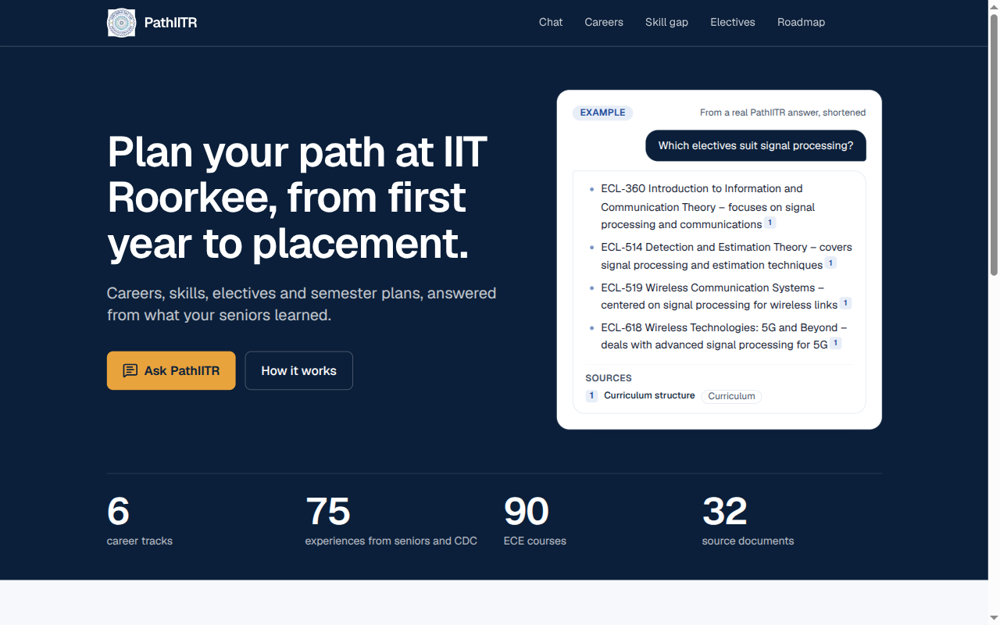
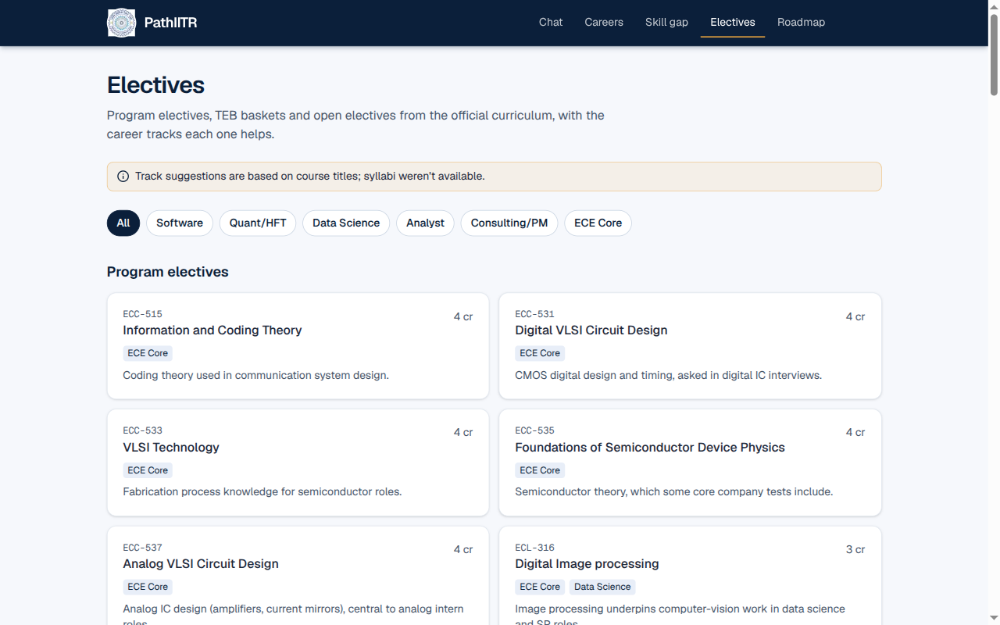
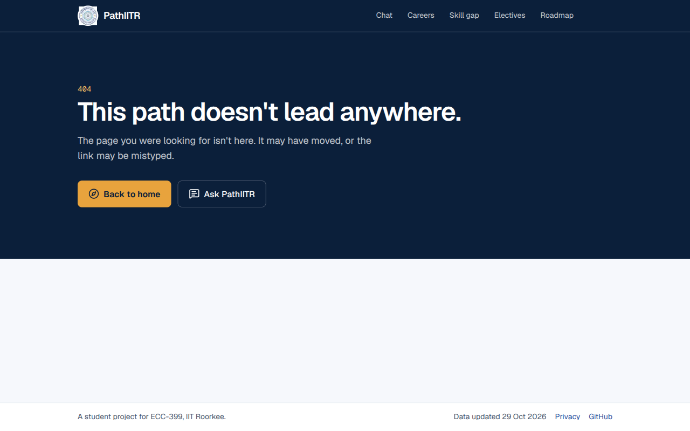

# PathIITR

AI-assisted career and academic guidance for IIT Roorkee students, built for **ECC-399 (ECE CORE)**.
Ask a question and get an answer written from seniors' experiences and the official curriculum, with
every point cited to the document it came from. Around the chatbot sit a career path recommender,
skill-gap analysis, elective guidance and a semester roadmap. ECE is covered in depth; other branches
get basic coverage.

| Landing page | Electives |
|---|---|
|  |  |



All pages except the landing page need an `@iitr.ac.in` Google login. The screenshots above show only
public or non-personal content.

## Features

- **Chatbot with citations.** Answers only from retrieved context, names the document and track behind
  each point, and says plainly when the data doesn't cover a question. Thumbs up/down on every answer
  is stored for review. Repeated questions are served from a cache.
- **Career path recommender.** Interests, skills and target tracks give a ranked list of tracks
  (Software, Quant/HFT, Data Science, Analyst, Consulting/PM, ECE Core) with reasons. The scoring is
  rule-based and unit-tested; the LLM only rewrites the reasons into a short summary.
- **Skill-gap analysis.** Your skill ratings against each track's skill matrix, with learning resources
  taken only from links found in the source documents.
- **Elective guidance.** Program electives, TEB baskets and open electives from the official curriculum,
  tagged with the career tracks each one helps.
- **Semester roadmap.** A plan up to Year 4 Spring: core courses, suggested electives and skills to
  build each semester, printable as PDF.
- **Profile and privacy controls.** Clear chat history or delete all your data from the profile page.

## Architecture

```
 Browser ──► Next.js (App Router, TypeScript, Tailwind) on Vercel
               │   proxy.ts: session refresh + IITR-only gate
               │
               ├─► Supabase Auth (Google login, @iitr.ac.in only)
               ├─► Supabase Postgres + pgvector (content tables, profiles, chats; RLS on everything)
               ├─► Supabase Edge Function `embed` (gte-small) ── embeds the question
               └─► lib/llm.ts ── Groq gpt-oss-120b → Groq qwen3.8-27b → Gemini (on 429 / timeout)
```

- **Retrieval.** The question is embedded with gte-small (384 dims) in an Edge Function; the
  `match_chunks` SQL function returns the top few chunks by cosine similarity (HNSW index, capped at 8),
  slightly favouring seniors' advice over reference summaries. Only those chunks go into the prompt.
- **LLM chain.** `lib/llm.ts` is the only place that calls a model. It tries Groq's `openai/gpt-oss-120b`,
  then Groq's `qwen/qwen3.8-27b` (a separate rate-limit bucket), then Gemini's free tier, moving on
  automatically on rate-limit errors, and shows a friendly "busy, try again shortly" message if all fail.
  Free tiers only, no paid APIs.
- **Embeddings** are computed locally for the documents (`scripts/embed.py`, ONNX) and by the Supabase
  Edge Function for questions. Both use the same model and pooling, so they share one vector space.
- **Rules, not LLM, where possible.** Recommender, skill gap, electives and roadmap are deterministic
  TypeScript (`lib/careers/`, tested with `npm test`); the LLM is used for chat answers and for short
  friendly rewrites only.

## Data pipeline

Python scripts in `scripts/` turn raw material (kept outside git in `data/`) into rows in Supabase:

1. `inventory.py`: list every file, merge exact and near duplicates, assign a track and a display title
   with no personal names.
2. `extract.py`: text from PDF, DOCX and PPTX, with Tesseract OCR for scanned pages.
3. `anonymise.py`: regex removal of emails, phones, roll numbers and profile links; names replaced
   (spaCy plus signature-line rules) in seniors' material; a review report for anything uncertain.
4. `structure.py`: an LLM structures each document (experiences, tips, resource lists, summaries),
   run slowly and resumably to respect free-tier limits.
5. `extract_courses.py` and `check_skill_matrix.py`: parse the curriculum into courses and slots, and
   validate the hand-built skill matrix.
6. `embed.py`: split into chunks and embed locally with gte-small.
7. `load.py`: idempotent upload to Supabase using the secret key; never touches user tables.

`harvest_links.py` collects every link in the documents so that any resource URL the app shows can be
traced to a source, and `site_stats.py` writes the committed counts shown on the landing page.

## Privacy and security

- **IITR-only login.** Google sign-in is accepted only for `@iitr.ac.in` addresses (department
  subdomains included); other accounts are signed out immediately. The same rule is enforced in the
  proxy, in the database (`is_iitr_user()`) and in the `embed` Edge Function.
- **Anonymisation before storage.** Names, emails, phones, roll numbers and profile URLs are stripped
  before anything is loaded into Supabase. Original file names are never stored or shown.
- **Row Level Security everywhere.** Content tables are read-only for signed-in IITR users and written
  only by the loader with the secret key. Profiles, conversations, messages and feedback are own-rows
  only. The answer cache is server-only. Anonymous visitors get no grants at all.
- **RLS tests.** `supabase/tests/rls_tests.sql` is a SQL suite that seeds fake users,
  runs each check as `anon` or `authenticated` with forged claims, and rolls everything back. Paste it
  into the SQL Editor after each migration; the first row reports whether all tests passed. It is run
  by hand, not in CI.
- **No resume storage.** No resume table exists. Questions that look like they contain personal details
  skip the answer cache.
- **Third-party AI providers.** Questions and the retrieved passages are sent to Groq and Google Gemini (free tiers) to generate answers. Gemini's free tier may use inputs to improve Google's products. No profile data or names are sent: a prompt holds only the question text and the retrieved passages.
- **User control.** Clear chat history or delete your data from `/profile`; `/privacy` explains what is stored.
- **Repo hygiene.** The repo is public and code-only. `data/` and `.env*` are gitignored, and a
  pre-commit hook blocks data files, large files, API keys, full IITR email addresses and phone numbers.
- **Abuse limits.** Per-user chat rate limit, and the embedding function is callable only by signed-in IITR users.

## Known limitations

- **No placement data.** Nothing here covers placement statistics, cutoffs or packages; the chatbot says
  so instead of guessing. Content is seniors' experiences and curriculum documents only.
- **Title-based elective mapping.** Which tracks an elective helps is inferred from course titles because
  syllabi weren't available, so some suggestions are approximate. The electives page says this.
- **Thin Quant/HFT and Data Science material.** These tracks have far less source material than
  Software and ECE Core, so answers there are shorter and less certain.
- **ECE-centred.** Other branches get the skill plan and general tracks, not branch-specific courses.
- **Free-tier limits.** Heavy use can hit the LLM rate limits; the app falls back and may show a busy message.
- **Resume analyser not built.** It was the lowest priority and is not included.
- **RLS tests are manual,** not part of an automated CI run.

## Setup

1. Clone the repo and install the git hooks (required, blocks data files and secrets from being committed):

   ```bash
   bash scripts/setup-hooks.sh
   ```

2. Install dependencies:

   ```bash
   npm install
   ```

3. Create `.env.local` in the project root with your own values (never commit this file):

   ```bash
   GROQ_API_KEY=<your-groq-key>
   GEMINI_API_KEY=<your-gemini-key>
   NEXT_PUBLIC_SUPABASE_URL=<your-supabase-project-url>
   NEXT_PUBLIC_SUPABASE_PUBLISHABLE_KEY=<your-supabase-publishable-key>
   SUPABASE_SECRET_KEY=<your-supabase-secret-key>
   NEXT_PUBLIC_SUPPORT_EMAIL=<your-support-email>
   ```

   | Variable | Used by | Placeholder |
   |---|---|---|
   | `GROQ_API_KEY` | `lib/llm.ts`, Python scripts (primary LLM) | `<your-groq-key>` |
   | `GEMINI_API_KEY` | `lib/llm.ts`, Python scripts (fallback LLM) | `<your-gemini-key>` |
   | `NEXT_PUBLIC_SUPABASE_URL` | web app, loader scripts | `<your-supabase-project-url>` |
   | `NEXT_PUBLIC_SUPABASE_PUBLISHABLE_KEY` | web app (browser-safe) | `<your-supabase-publishable-key>` |
   | `SUPABASE_SECRET_KEY` | server-side code and loader scripts only | `<your-supabase-secret-key>` |
   | `NEXT_PUBLIC_SUPPORT_EMAIL` | contact line on `/privacy` (falls back to the GitHub repo if unset) | `<your-support-email>` |
   | `LLM_DEBUG_FAIL` | optional, dev only: steps of the LLM chain that act as rate-limited, a comma list of `groq`, `groq-backup`, `gemini`, or `all` | unset |
   | `CHAT_RATE_LIMIT` | optional, dev only: questions per user per 10 minutes in `/api/chat` (default 15) | unset |

   In dev, `/api/llm-test?q=<question>` (login required) tries the LLM wrapper; it returns 404 in production.

4. Set up Google login (Supabase → Authentication):

   - Providers → Google: enable it with the client ID/secret of a Google Cloud OAuth client whose
     authorized redirect URI is `https://<your-project-ref>.supabase.co/auth/v1/callback`.
   - URL Configuration → Redirect URLs: add `http://localhost:3000/**`
     (and `https://<your-vercel-domain>/**` once deployed). The `**` is needed because the callback
     URL carries a `?next=` query; without a match Supabase silently sends you to the Site URL.

   Only `@iitr.ac.in` emails (including department addresses like `@ece.iitr.ac.in`) are let in;
   anyone else is signed out straight away. Every page except the landing page needs login.

5. Deploy the `embed` Edge Function, which embeds chat questions with gte-small (the model
   `scripts/embed.py` uses) and only serves logged-in IITR users. Log in once in a normal terminal
   (the login needs an interactive shell), then deploy:

   ```bash
   npx supabase@2 login
   npx supabase@2 functions deploy embed --use-api --project-ref <your-project-ref>
   ```

6. Run the SQL migrations in `supabase/migrations/` in the Supabase SQL Editor, oldest first
   (`20261029120000_initial_schema.sql`, then `20261029180000_profile_onboarding.sql`, then `20261029200000_skill_gap_priorities.sql`). After a
   migration, paste `supabase/tests/rls_tests.sql` into the SQL Editor; row 0 should say all tests passed.

7. Run the dev server:

   ```bash
   npm run dev
   ```

   `npm test` runs the recommender's unit tests (`node --test`, Node 22.18+ for TypeScript type stripping).

## Python scripts

Data scripts in `scripts/` (extraction, OCR, anonymisation, structuring, loading) run in a virtualenv.
OCR needs the system Tesseract binary:

```bash
sudo apt install tesseract-ocr
python3 -m venv .venv
source .venv/bin/activate
pip install -r scripts/requirements.txt
```

Old `.doc`/`.ppt` files are converted only if LibreOffice is installed (optional: `sudo apt install libreoffice`).

Pipeline order: `python scripts/inventory.py`, `python scripts/extract.py`, then
`python scripts/anonymise.py` (writes `data/work/clean/` and a review report, `data/work/anonymise_report.csv`).
After `python scripts/structure.py`, run `python scripts/embed.py` to chunk and embed the clean documents
into `data/work/chunks.jsonl` (the gte-small model, ~130 MB, downloads once into `~/.cache/huggingface`).
`python scripts/embed.py --search "<question>"` prints the top matching chunks.
`python scripts/site_stats.py` refreshes the landing-page counts in `lib/site-stats.json` (counts only, committed,
since Vercel can't see `data/`); re-run it and commit after the data changes.

Scripts read keys from `.env.local` (see the table above).

## Data and confidentiality

This repo is public and contains code only.

- Source material (PDFs, slides, Notion exports, extracted text, embeddings) lives in `data/`, which is gitignored.
- All data is anonymised (names, emails, phone numbers, roll numbers, profile URLs removed) before it is stored in Supabase.
- Content derived from seniors' material is shown only to logged-in IITR users.
- The pre-commit hook in `scripts/hooks/pre-commit` blocks anything under `data/`, `.env*` files,
  files over 1 MB, API keys, full IITR email addresses and phone numbers.

## Docs

- `docs/decisions.md`: one-line log of significant decisions.
